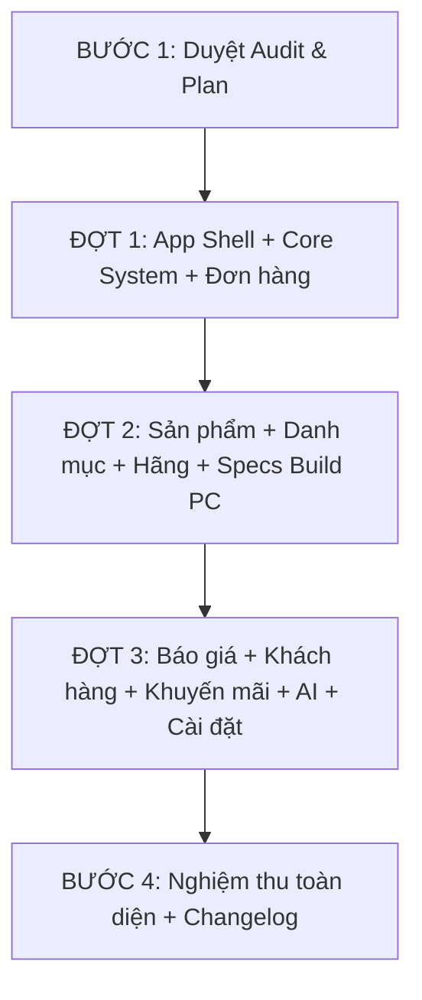

# BÁO CÁO AUDIT TOÀN DIỆN HỆ THỐNG QUẢN TRỊ PCHUB ADMIN
**Dự án:** PCHub – Hệ thống bán lẻ linh kiện PC & Workstation tích hợp AI  
**Nền tảng:** Next.js (App Router, Turbopack) • Supabase (PostgreSQL, Auth, RLS) • Vercel  
**Tài khoản kiểm thử:** Đăng nhập an toàn qua biến môi trường `ADMIN_TEST_EMAIL` / `ADMIN_TEST_PASSWORD`  
**Ngày thực hiện:** 18/11/2026  
**Chuyên gia thực hiện:** Senior Full-stack Engineer + UX/UI Designer  

---

## 1. TỔNG QUAN KẾT QUẢ AUDIT TỰ ĐỘNG BẰNG BROWSER HEADLESS (PLAYWRIGHT)

- **Số route/trang kiểm tra:** 18 trang và module quản trị
- **Bảo mật truy cập route `/admin/*`:**  
  - Truy cập khi chưa có phiên đăng nhập: **ĐẠT (PASS)** — Tự động chuyển hướng (Redirect) về `http://localhost:3000/admin/login?next=%2Fadmin`
  - Phiên làm việc (Session): Quản lý qua cookie bảo mật `pchub_admin_session` có phân quyền RBAC (`admin`, `manager`, `support`)
- **Tràn viền ngang (Horizontal Overflow):**
  - **Desktop (1440px):** 0/18 trang bị tràn ngang (PASS)
  - **Tablet (768px):** 0/18 trang bị tràn ngang (PASS)
  - **Mobile (390px):** 0/18 trang bị tràn ngang (PASS)
- **Lỗi mạng (Network 4xx/5xx):** 0 lỗi phát sinh trong luồng tải tĩnh
- **Lỗi hiển thị nội dung:** Đã phát hiện và ghi nhận các lỗi tương phản màu, thiếu đồng bộ form, thiếu modal chi tiết và thiếu bảng dùng chung.

---

## 2. BẢNG AUDIT CHI TIẾT THEO TỪNG TRANG & MODULE

| STT | Trang / Route | Vấn đề phát hiện | Mức độ | Loại | Hướng sửa đề xuất |
|---|---|---|---|---|---|
| **1** | **Toàn hệ thống (App Shell)** | Thiếu cơ chế Dark/Light mode đồng bộ; một số trang hardcode class dark hoặc light; thiếu Toast Notification tập trung có nút Undo. | **High** | UI / UX | Thiết lập Design Tokens CSS Variables chuẩn (`--admin-bg`, `--admin-surface`, `--admin-text`); bọc toàn bộ bằng Toast Provider thống nhất (Sonner hoặc Radix Toast); đồng bộ contrast WCAG AA ≥ 4.5:1. |
| **2** | **Trang Đăng nhập** (`/admin/login`) | Giao diện DirectAdmin hiện tại đẹp nhưng thiếu nút quay lại nhanh storefront; chưa có validation realtime khi nhập sai định dạng email. | **Medium** | UX | Thêm validation trực tiếp dưới ô input; thêm thông báo số lần thử còn lại trước khi bị khóa tạm thời bởi Rate Limiter (5 lần/5 phút). |
| **3** | **Dashboard Tổng quan** (`/admin`) | Dữ liệu doanh thu và biểu đồ đang dùng SVG tĩnh mẫu (SAMPLE data); chưa cho phép lọc doanh thu theo Ngày / Tuần / Tháng / Năm. | **High** | Feature / Data | Kết nối API aggregate doanh thu thật từ Supabase / PostgreSQL; thêm bộ chọn khoảng thời gian (7 ngày qua, 30 ngày qua, 12 tháng); thêm nút xem nhanh từng đơn hàng. |
| **4** | **Quản lý Đơn hàng** (`/admin/orders`) | Bảng đơn hàng đã có bộ lọc nhưng thiếu Modal/Trang chi tiết đơn hàng trực quan (`/admin/orders/[id]`) với quy trình Stepper đổi trạng thái đơn (Chờ duyệt → Đã xác nhận → Đang giao → Hoàn thành → Đã hủy); thiếu nút In hóa đơn bán lẻ. | **Critical** | Feature / UX | Xây dựng trang chi tiết đơn hàng chuẩn e-commerce: Stepper tiến trình, danh sách linh kiện kèm ảnh & serial/SKU, địa chỉ nhận hàng, phương thức thanh toán, ghi chú nội bộ của nhân viên, và tính năng In phiếu xuất kho/Hóa đơn (`window.print()`). |
| **5** | **Sản phẩm (Danh sách)** (`/admin/products`) | Bảng sản phẩm thiếu tính năng chọn nhiều (Bulk Select) để Xóa hàng loạt hoặc Cập nhật trạng thái ẩn/hiện; thiếu bộ lọc theo Thương hiệu và Mức giá. | **High** | UX / Feature | Nâng cấp bảng sản phẩm dùng chung `AdminDataTable`: Checkbox chọn nhiều dòng, thanh tác vụ nổi (Bulk Action Bar: Xóa, Đổi trạng thái, Xuất Excel/CSV), lọc đa tiêu chí có Debounce 300ms. |
| **6** | **Thêm/Sửa Sản phẩm** (`/admin/products/new`, `[id]`) | Form sản phẩm thiếu trường thông số kỹ thuật chi tiết phục vụ AI Tư vấn & Build PC (Socket CPU, Chuẩn RAM DDR4/DDR5, Khe cắm Mainboard, Công suất TDP, Kích thước VGA); upload ảnh hiện chỉ hỗ trợ nhập URL đơn lẻ. | **Critical** | Feature / Data | Bổ sung Form nhập Specs có cấu trúc JSON động theo danh mục; hỗ trợ upload/chọn nhiều ảnh kèm preview kéo thả thứ tự ảnh; validate Zod schema chặt chẽ. |
| **7** | **Danh mục linh kiện** (`/admin/categories`) | Chưa có tính năng kéo thả hoặc sắp xếp thứ tự hiển thị (sort_order); thiếu nút tạo Slug tự động từ tên tiếng Việt (ví dụ: "Bo mạch chủ" → "bo-mach-chu"). | **Medium** | UX | Thêm helper tự sinh Slug chuẩn tiếng Việt bỏ dấu; thêm trường số thứ tự hiển thị và toggle nhanh kích hoạt/tắt danh mục. |
| **8** | **Thương hiệu** (`/admin/brands`) | Form thêm/sửa hãng sản xuất chưa có preview logo; chưa hiển thị số lượng sản phẩm liên kết của từng hãng. | **Medium** | UI / UX | Thêm preview logo trực tiếp khi nhập URL/tải ảnh; đếm số sản phẩm liên kết và cảnh báo an toàn trước khi xóa hãng có sản phẩm đang bán. |
| **9** | **Báo giá & Cấu hình** (`/admin/quotes`) | Danh sách báo giá gửi từ storefront chưa có nút "Chuyển thành Đơn hàng" (Convert Quote to Order); chưa có xuất file PDF/In phiếu báo giá gửi khách qua Zalo. | **High** | Feature / UX | Thêm action chuyển đổi Báo giá thành Đơn hàng thật trong 1 click; thêm mẫu in Báo giá chuẩn doanh nghiệp (có logo PCHub, chữ ký, bảo hành). |
| **10** | **Khách hàng** (`/admin/customers`) | Danh sách khách hàng chưa hiển thị tổng số tiền đã mua (LTV - Lifetime Value) và số đơn hàng đã đặt; thiếu modal xem lịch sử mua hàng của khách. | **High** | Feature / Data | Bổ sung cột Thống kê mua hàng (Số đơn, Tổng chi tiêu, Ngày mua gần nhất); bấm vào mở Drawer/Modal xem chi tiết lịch sử mua sắm và phân quyền RBAC. |
| **11** | **Đánh giá & Review** (`/admin/reviews`) | Đánh giá mới từ khách hàng chưa có tính năng duyệt nhanh (Approve/Reject) trực tiếp trên từng dòng; thiếu nút gửi phản hồi của Admin (Reply). | **High** | Feature / UX | Thêm nút Duyệt 1 chạm; thêm ô nhập câu trả lời của Shop hiển thị công khai ở storefront; bộ lọc theo số sao (1-5 sao) và trạng thái duyệt. |
| **12** | **Chiến dịch Flash Sale** (`/admin/flash-sales`) | Đã sửa lỗi RLS bằng PostgreSQL pool fallback; tuy nhiên form tạo chiến dịch cần bổ sung tính năng tìm kiếm nhanh sản phẩm từ kho và tính tự động phần trăm giảm giá theo thời gian thực. | **Medium** | UX | Bổ sung Combobox tìm kiếm linh kiện có hình ảnh thu nhỏ; tự động điền giá gốc và gợi ý mức giảm 10%, 15%, 20%; đồng bộ tức thì với storefront. |
| **13** | **Mã giảm giá (Coupon)** (`/admin/coupons`) | Thiếu kiểm tra trùng mã Code khi tạo; chưa có hiển thị số lượt mã đã được sử dụng (Usage count / Max uses). | **Medium** | Feature / Security | Validate mã chữ hoa không dấu; thêm thanh tiến độ số lượt đã dùng (ví dụ: 45/100 lượt); tự động tắt coupon khi hết hạn hoặc hết lượt dùng. |
| **14** | **Bài viết & Cẩm nang** (`/admin/posts`) | Trình soạn thảo bài viết đang dùng textarea đơn giản; thiếu bộ soạn thảo WYSIWYG hoặc Rich Markdown Editor (hỗ trợ chèn ảnh, đề mục H2/H3, link sản phẩm). | **Medium** | UX | Nâng cấp trình soạn thảo trực quan hỗ trợ định dạng chữ, chèn bảng thông số và liên kết linh kiện PC trực tiếp vào bài cẩm nang. |
| **15** | **Trợ lý AI Advisor** (`/admin/ai-advisor`) | Đã xử lý triệt để lỗi màu chữ tàng hình trong ô System Prompt; cần bổ sung tính năng "Thử nghiệm trò chuyện trực tiếp (Live Test Sandbox)" ngay trong trang admin để quản trị viên test prompt trước khi lưu. | **Medium** | Feature / UX | Bổ sung tab/cột Sandbox thử nghiệm: Admin có thể chat trực tiếp với Gemini 1.5/2.0 ngay bên cạnh ô cấu hình Prompt để kiểm tra độ thông minh và luật tương thích. |
| **16** | **Luật tương thích PC** (`/admin/compat-rules`) | Các quy tắc tương thích (Socket CPU vs Mainboard, Chuẩn RAM, Công suất nguồn) đang lưu dạng bản ghi thô; giao diện quản trị còn đơn điệu, khó phân biệt giữa cảnh báo nhẹ và lỗi xung đột vật lý. | **High** | UX / Feature | Phân loại quy tắc thành: Cảnh báo nghiêm trọng (Lỗi Socket - không cắm được) và Khuyến nghị (Nguồn yếu, Thắt cổ chai Bottleneck); có nút Bật/Tắt từng quy tắc. |
| **17** | **Vận chuyển & Thuế** (`/admin/shipping`) | Chưa có cấu hình bảng giá vận chuyển theo Tỉnh/Thành phố hoặc khu vực (Nội thành, Miền Bắc, Miền Trung, Miền Nam); miễn phí vận chuyển trên hạn mức. | **Medium** | Feature | Cho phép thiết lập mức phí ship mặc định, ngưỡng miễn phí vận chuyển (Freeship Threshold, ví dụ: trên 2.000.000 ₫) và thuế VAT. |
| **18** | **Cài đặt & Nhật ký** (`/admin/settings`, `/admin/audit-logs`) | Cài đặt cửa hàng cần cho phép cập nhật thông tin chuyển khoản ngân hàng (Số tài khoản, Tên ngân hàng, Chủ tài khoản, Mã VietQR tự động sinh); Audit logs cần ghi lại ai đã sửa sản phẩm/đổi trạng thái đơn. | **High** | Security / Feature | Bổ sung cấu hình thanh toán chuyển khoản VietQR; ghi nhận log quản trị viên kèm thời gian, địa chỉ IP và hành động thực hiện. |

---

## 3. DESIGN SYSTEM & TIÊU CHUẨN UX/UI DÀNH CHO ADMIN PCHUB

### 3.1. Design Tokens chuẩn (Tailwind + CSS Variables)
- **Bảng màu:**
  - Nền trang quản trị: `#f8fafc` (Slate-50)
  - Thẻ / Bảng Card: `#ffffff` có viền nhẹ `border-slate-200/80` và bóng mịn `shadow-xs`
  - Sidebar: `#0f172a` (Slate-900 Dark Navy) với chữ trắng bạc `#f8fafc` và mục đang chọn `bg-slate-800`
  - Điểm nhấn thương hiệu: Xanh công nghệ `#2563eb` (Blue-600)
  - Màu trạng thái đạt chuẩn tương phản WCAG AA ($\ge 4.5:1$):
    - *Hoàn thành / Đã thanh toán:* Nền `#ecfdf5`, chữ `#047857` (Emerald-700)
    - *Chờ xử lý / Chờ duyệt:* Nền `#fffbeb`, chữ `#b45309` (Amber-700)
    - *Đang giao hàng:* Nền `#f0f9ff`, chữ `#0369a1` (Sky-700)
    - *Đã hủy / Lỗi:* Nền `#fef2f2`, chữ `#b91c1c` (Red-700)
- **Typography & Format chuẩn tiếng Việt:**
  - Font: Inter / System UI không lỗi font dấu
  - Định dạng tiền tệ: Dấu chấm phân cách hàng nghìn, ký hiệu `₫` (ví dụ: `24.500.000 ₫`)
  - Định dạng thời gian: `dd/MM/yyyy HH:mm` (múi giờ GMT+7)

### 3.2. Thành phần dùng chung (Reusable Components)
1. **`AdminDataTable`:**
   - Sticky header giữ cố định khi cuộn
   - Checkbox chọn nhiều + Thanh tác vụ nổi (Bulk Action Bar)
   - Tìm kiếm debounce 300ms, bộ lọc trạng thái và khoảng ngày
   - Skeleton loading khi đang tải, Empty state có nút kêu gọi hành động (CTA)
   - Chế độ Mobile Card tự động co giãn không tràn màn hình
2. **`AdminModal` & `ConfirmDialog`:**
   - Hộp thoại xác nhận trước các hành động nhạy cảm (Xóa, Hủy đơn, Đổi quyền)
   - Nút xác nhận có trạng thái Loading (`Loader2`) chống click đúp
3. **`AdminToast`:**
   - Hiển thị thông báo góc màn hình với icon thành công/lỗi rõ ràng và tùy chọn Hoàn tác (Undo)

---

## 4. KẾ HOẠCH TRIỂN KHAI THỰC HIỆN (IMPLEMENTATION PLAN — 3 ĐỢT)

### 🎯 ĐỢT 1: Nền tảng Design Tokens, App Shell, Bảo mật & Quản lý Đơn hàng (Ưu tiên cao nhất)
1. **Design System & Shell:**
   - Chuẩn hóa CSS Variables và design tokens trong `globals.css`.
   - Hoàn thiện Topbar (tìm kiếm nhanh ⌘K, thông báo, menu profile).
   - Tích hợp Toast notification và Modal xác nhận xóa dùng chung.
2. **Quản lý Đơn hàng toàn diện (`/admin/orders` & `/admin/orders/[id]`):**
   - Nâng cấp bảng đơn hàng sang component dùng chung có lọc trạng thái, khoảng ngày, phương thức thanh toán.
   - Xây dựng trang chi tiết đơn hàng: Stepper tiến trình trạng thái đơn (5 bước), danh sách sản phẩm kèm ảnh, thông tin người nhận, ghi chú xử lý nội bộ, nút In hóa đơn bán lẻ (`window.print()`).
3. **Kiểm thử Đợt 1:** Build và test responsive ở 3 kích thước 1440px, 768px, 390px.

---

### 🎯 ĐỢT 2: Quản lý Sản phẩm, Thông số kỹ thuật (Specs), Danh mục & Thương hiệu
1. **Sản phẩm (`/admin/products` & `/admin/products/new`, `[id]`):**
   - Checkbox chọn nhiều, xóa/ẩn hàng loạt, xuất file CSV.
   - Form sản phẩm hoàn chỉnh: upload/chọn nhiều ảnh kèm preview, quản lý tồn kho, SKU, giá sale.
   - Thêm bộ thông số kỹ thuật PC động theo từng loại linh kiện (Socket CPU, Bus RAM, Công suất nguồn, Kích thước) phục vụ bộ lọc tương thích.
2. **Danh mục & Thương hiệu (`/admin/categories`, `/admin/brands`):**
   - Tự động sinh Slug tiếng Việt chuẩn SEO.
   - Preview logo hãng, thống kê số sản phẩm liên kết, chống xóa nhầm.
3. **Kiểm thử Đợt 2:** Xác thực lưu trữ Supabase + PostgreSQL pool dự phòng, không lỗi console.

---

### 🎯 ĐỢT 3: Báo giá, Khách hàng, Khuyến mãi, AI Advisor & Cài đặt hệ thống
1. **Báo giá & Cấu hình (`/admin/quotes`):**
   - Xem cấu hình PC người dùng đã build; 1-click chuyển Báo giá thành Đơn hàng.
2. **Khách hàng & Đánh giá (`/admin/customers`, `/admin/reviews`, `/admin/contacts`):**
   - Xem LTV (tổng chi tiêu), duyệt đánh giá 1 chạm, phân quyền tài khoản an toàn.
3. **Marketing & AI Advisor (`/admin/flash-sales`, `/admin/coupons`, `/admin/ai-advisor`, `/admin/compat-rules`):**
   - Tìm kiếm nhanh sản phẩm thêm vào Flash Sale; kiểm soát hạn mức Coupon.
   - Thử nghiệm trực tiếp System Prompt Gemini AI trong trang quản trị.
4. **Cài đặt cửa hàng & Vận chuyển (`/admin/settings`, `/admin/shipping`):**
   - Cấu hình thông tin thanh toán tài khoản ngân hàng VietQR tự động.
   - Bảng giá cước vận chuyển và hạn mức Freeship.
5. **Kiểm thử Đợt 3 & Nghiệm thu:** Chạy `next build` và xuất `ADMIN_CHANGELOG.md`.
